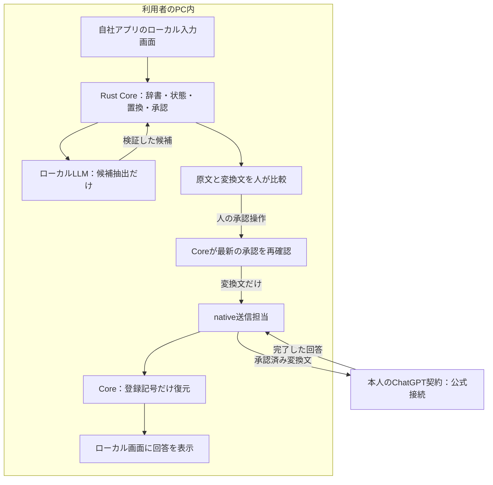

# 検査・承認・送信をどうつなぐか

以下はnative実装後の構成です。配布直後に実行できるのは架空データのブラウザ体験版と、通信しない組み込み例です。

利用者は自分のチャット画面に文章を書きます。PC内の小さなモデルが機密候補を見つけ、通常のプログラムが名前などを相談ごとの記号に置き換えます。人が見比べて承認すると、その変換文だけがChatGPTへ渡ります。回答の記号はPC内で元に戻します。

原文・辞書・対応表・復元済み回答はPC内の領域から出しません。認証のためには別の通信を使いますが、認証URLやログに本文を入れません。通信の暗号化は、送信先から内容を隠す機能ではありません。外部AIは承認した変換文の内容を読めます。

## 各部品の権限

| 部品 | 受け取るもの | 担当すること |
| --- | --- | --- |
| ローカル画面 | 原文、比較、復元文 | 入力と明示確認。外部HTML・画像は読み込まない |
| SDK | 原文・目的・送信予定先、Coreの状態 | ローカルIPCを呼ぶ。外部HTTPやログ出力をしない |
| Rust Core | 原文、辞書、検査結果、案件・版 | 辞書照合、トークン生成、失効、送信許可、完全一致復元 |
| worker | 検査対象本文 | 候補と分類を返す。ネットワーク・送信判断・復元を担当しない |
| native送信担当 | 有効な承認ID | Coreの出口から変換文だけを得て、固定公式接続へ送る |
| 外部AI | 変換文 | 契約と利用枠に従って回答する |

同じMacプロセス内の責務分離を、端末乗っ取りへの防御と混同しません。nativeホスト自体は信頼するコードです。Tauriの権限、読み込むページ、workerのOS隔離も別途検証します。

## 呼び出しの順序

1. `prepare({original, purpose, destination})` がCoreを更新し、jobを作る。nativeでは実workerが終了するまで実状態を待つ。
2. Coreが範囲・JSON・処理完了・既知機密の残存を検証し、`REVIEW` または停止を返す。
3. UIは原文・変換文・外へ残る情報・失う意味を表示する。この時点では送信しない。
4. 人の確認操作で `approve(review.revision)` を呼び、Coreが承認IDを発行する。
5. `sendNative(approvalId)` はローカルIPCの `api_send({approvalId})` を呼ぶ。本文を引数にしない。
6. nativeは接続・モデルの生存と構成を確認し、Coreロック内の `export_approved_with` で承認を再検査する。
7. 送信担当はその出口から受け取った変換文だけを送る。受信完了と形式が確定するまで復元しない。
8. `restore_if_current` で同じ案件・版かを確認し、この相談で実際に持ち出したトークンだけを戻す。

SDKの `Snapshot` はローカル表示用で、原文や辞書を含みます。外部リクエストに丸ごと入れたり、エラー監視へ渡したりしないでください。

## 変更・失敗の扱い

本文、目的、送信先、辞書、ポリシー、モデル構成を変えたら承認を破棄します。ChatGPT契約のモデルや接続の変更もnativeで承認へ結び付けます。別jobや古い版の検査結果は採用しません。

モデル未準備、停止、不正JSON、未処理部分、入力上限、認証失敗、利用枠不足、途中の回答は停止理由になります。原文送信・別クラウド検査・APIキー方式への自動切替で代用しません。送信の成功が不明な場合は自動再送しません。取消しで、既に外部へ届いた文章を取り戻すことはできません。

## 自社Webアプリに組み込む場合

機密原文をクラウドへ上げる前に、入力画面と会話の組立てをローカルのデスクトップ側へ置きます。既存のWebフォームが入力ごとにサーバーへ自動保存しているなら、送信直前にクッションAIを挟むだけでは原文をPC内に留められません。

初期対象は短い1回の相談です。履歴・検索資料・添付・非表示の指示も外へ送るなら、それらを含む最終要求全体をローカルで検査して承認する必要があります。復元済み回答を次の履歴としてそのまま外へ送り返さないでください。
